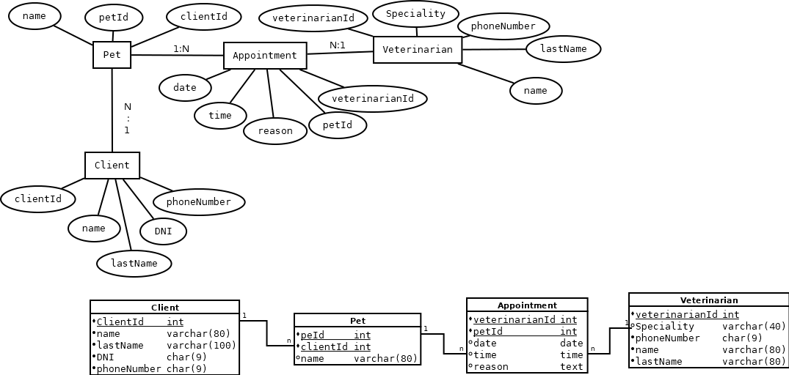

## This new personal project will be similar to a previous one I developed:
 a Workshop Management System. However, this time, it will be designed for a veterinary clinic. The main difference is the use of Hibernate and HQL, which provide a much simpler and more efficient approach to developing this type of application compared to traditional JDBC.

## The project will have the same purpose as my previous Workshop Management System: to design and develop a complete database management application from scratch.
    The project will involve:

    Relational database design: Creating the relational model for a veterinary clinic, defining its entities, relationships and constraints.
    Database development: Building the database from scratch using SQL.
    Application development:Developing a Java-based terminal application using Hibernate and HQL to interact with and manage the database in a simpler and more efficient way than with traditional JDBC.

    The main goal is to apply database design and object-relational mapping concepts to a real-world scenario while gaining practical experience with Hibernate and HQL.

## Database Design:

    

    In this first phase, we created the Entity-Relationship (ER) Model and the Relational Model for our company. I decided to keep things simple by creating just four basic tables rather than making the database more complex, since this is my first Hibernate project since learning it in class.